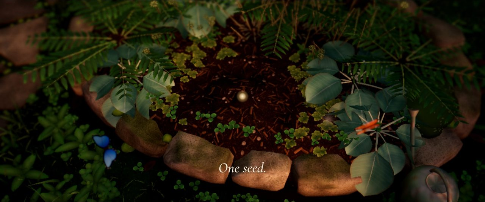

# Meadow

Grow a flower, gift your love: a living garden in the real Bangalore weather.

Meadow is a return gift for the office birthday celebration on Tuesday 10 November 2026. At the party, colleagues scan
a QR code on the big screen, choose a flower, give their garden a name and plant a seed. The seed grows in the real
Bangalore weather: rain waters it, a hot dry afternoon dries the soil, and too much water rots the roots. Looked after
a little each day, it blooms in about two weeks; neglected, it blooms later and smaller. Once it is in full bloom, its
grower can send it to someone they love: a golden-hour picture card with their own message, and a link to the living
flower. Everyone's flowers grow together in the shared Meadow, round a rose that is already in full bloom.

Planting opened early, and it is open to everyone. From 20 October to 10 December anyone can plant, party link or not,
and every planting on the live site is a real garden that keeps growing through the party and after it. A seed planted
from the party link is spared the limits that keep a flood of strangers out of the Meadow and off the big screen: a
seed without it waits after 60 new seeds in an hour or 300 in a day. Names are unique in the Meadow, so each person
plants once, under their own name, and a name with an offensive word in it is turned away (`lib/server/unkind.ts`).

Live at **https://meadow-phi.vercel.app**.

## The pages

| Page | What it is |
| --- | --- |
| `/garden` | Everyone's first stop. Without a garden it offers the seed (after 10 December, it shows the rose in bloom instead); on a device that holds a garden it opens that garden, with its care card and its sounds. The party link (`/garden?code=...`) opens it too. |
| `/meadow` | The shared Meadow: rings of beds and a slow river round the rose. Ride the lantern cart (or glide), visit a friend's flower, leave a sprinkle, find someone by name. |
| `/meadow/garden?plot=N` | A friend's garden, to look at only. |
| `/party?code=...` | The big screen for the party: the rose, the QR code that carries the party link, new seeds as they are planted, and a seventy-second trailer played in the live garden (below). |

There are eight flowers to choose from: Enchanted Rose, Sundrop, Magnolia, Marigold, Island Bloom, Night Jasmine, Pink
Lily and Lotus. The lotus grows in a small pond with koi, with its own water model.

A garden is tied to the device it was planted on. Its personal link (`/garden#k=...`) opens it on another phone or a
laptop; the key sits in the address's fragment, which browsers never send in a page request, and it is scrubbed from
analytics. The party code is never written into the code base: it lives in the `MEADOW_PARTY_CODE` setting on Vercel.

## How it works

- **App**: Next.js 16 (App Router, Cache Components) on Vercel, served from Mumbai (`bom1`).
- **3D**: three.js through React Three Fiber, drei and postprocessing, with quality tiers per device and the real sun
  position from suncalc. A colleague can choose the picture in the name pill's menu (Auto, Cinematic, Balanced or
  Light, `lib/garden/picture.ts`). Until they do, the garden opens on Cinematic, except on a device with an old or
  missing GPU, which opens on Auto (Auto picks for the device). The lantern cart drives on Rapier physics, with a gentle glide as the fallback.
- **The plant model** (`lib/sim`): plain TypeScript with no framework, so the same code runs on the server, in the
  tests and in the browser. A soil water balance (FAO-56), growth from sunlight, and development in thermal time that
  stress slows down; the lotus has its own pond model (`lib/sim/pond.ts`). It is deterministic and versioned.
- **Event-sourced state**: every care action is an event appended to the plant's log and never changed, weather hours
  are stored once and never rewritten, and a plant's state is the replay of its events against the weather, hour by
  hour, from its last checkpoint to now (`lib/server/catchup.ts`). Nothing runs on a timer: a garden catches up when
  someone opens it.
- **Weather**: [Open-Meteo](https://open-meteo.com) for the office in Bellandur, on the Outer Ring Road
  (`lib/sim/weather.ts`, `lib/server/open-meteo.ts`). Plants wait at a missing hour rather than grow on invented
  weather.
- **Data**: Supabase Postgres, reached with postgres.js (`lib/server/db.ts`). Migrations are in `db/migrations`;
  row-level security is on for every table, and the deployed app connects as `meadow_app`, a role that can read and
  append but never delete or change the schema.
- **Sound**: the garden's live soundscape and the sound tiles are in `lib/sound` and `public/garden/sounds`.
- **Search and link previews**: each public page's title and description, the short introduction that search engines
  and screen readers read where the canvas has no words, and the garden's schema.org data are in `app/seo.tsx`; the
  preview picture is `app/opengraph-image.jpg`, and `app/sitemap.ts` lists `/garden` and `/meadow`.

Where things are:

```
app/          pages, API routes (app/api), and the site's metadata, icons, robots and sitemap
components/   garden, gift, care, meadow, lotus, deer, party, sound
lib/          sim (plant model), server, client, garden, plant, sky, sound
db/           SQL migrations and the lockdown every migration re-applies
scripts/      maintenance scripts (below)
docs/         REHEARSAL.md, the party-week checklist, and the trailer's stills
```

## Running it locally

You need Node 22 or later.

```bash
npm install
```

```bash
npm run dev
```

Then open http://localhost:3000, which forwards to `/garden`.

The API needs the database. Its connection strings live in `.env.local`, which is never committed; ask the owner for
it, and keep it off shared screens. A development server plants without a party code, and everything it plants is
marked as a rehearsal: kept on the outer plots, hidden from the live Meadow, and removed with
`scripts/clear-rehearsals.mjs`. Settings the app and scripts read:

| Setting | Used for |
| --- | --- |
| `POSTGRES_URL` | the app's database connection (the pooler) |
| `POSTGRES_URL_NON_POOLING` | the direct connection the migrations use |
| `POSTGRES_CA_CERT`, `POSTGRES_TLS` | optional TLS overrides (by default the Supabase root certificate in `db/` is checked) |
| `MEADOW_PARTY_CODE` | the party code, on Production only: a seed planted with it is spared the limits on strangers' plantings |
| `MEADOW_PLANTING` | leave unset so anyone can plant; `party` asks for the party link again, should strangers ever need keeping out (redeploy after changing it) |
| `OPEN_METEO_API_KEY` | optional, for Open-Meteo's paid service |

Checks to run before a commit:

```bash
npx tsc --noEmit
```

```bash
npm run lint
```

```bash
npm test
```

## Scripts

Run them from the project folder with the secrets loaded, for example
`node --env-file=.env.local scripts/verify-db.mjs`. Each one explains itself, with every option, at the top of the
file. Those that remove or move people's gardens or sessions (`clear-rehearsals`, `find-duplicates`,
`prune-identity`, `convert-early-gardens`) only list what they would do until you add `--yes`.

| Script | What it does |
| --- | --- |
| `migrate.mjs` | applies pending migrations from `db/migrations`, then runs the security check |
| `verify-db.mjs` | checks that the schema is private and that `meadow_app` can do only what the app needs |
| `app-role.mjs` | gives the app its own limited login, `meadow_app` (step 2 of the rehearsal) |
| `backfill-weather.mjs` | finds and fills gaps in the stored weather |
| `smoke-api.mjs` | walks the real API end to end with two test seeds, then deletes everything it made |
| `find-duplicates.mjs` | finds people who may have planted twice, and removes a garden by plot |
| `hide-name.mjs` | hides, shows or changes a name on a garden sign |
| `clear-rehearsals.mjs` | removes rehearsal plantings made from a development server or a Preview |
| `seed-meadow-rehearsal.mjs` | fills a local Meadow with rehearsal plantings to look at, and clears them |
| `prune-identity.mjs` | removes device sessions and garden links a month after they stopped working |
| `bake-meadow-plants.mjs` | redraws the Meadow's far-plant pictures in `public/meadow` (no database needed) |
| `convert-early-gardens.mjs` | a one-off from 20 October that turned the first practice plantings into real gardens |

`scripts/lib` lets these scripts run `lib/sim`'s TypeScript directly, so they never keep their own copy of the model.

## The party

[docs/REHEARSAL.md](docs/REHEARSAL.md) is the calm checklist for the week before the party: making the party code,
giving the app its own login, a smoke test on the live site, trying it on real phones, the venue check on the real
laptop and screen, and the run sheet for the day.

### The trailer

The party screen can play a seventy-second trailer, cut like a film trailer but drawn live in the garden rather than
played from a video: a seed of light at dawn, its first drink from the watering can in slow motion, a day of growing
under the real Bangalore sky with a passing shower, the rose opening at golden hour, a doe who comes to look at it,
night and the lantern, the other flowers each named on black, the title, and "Your seed is waiting." Then the panel
and its QR code come back by themselves.

<p>
  
  
  
  
</p>

It is made for the venue laptop rather than phones. Move the mouse and press **Play the trailer** in the top left corner, or
press **D**; **D** again stops it at any moment and the panel comes back. Its music is composed in code, a music box
over real garden recordings (all CC0); **M** mutes it, and `&music=off` at the end of the address leaves it out. A
laptop too slow for the look plays the trailer slower rather than skipping, so time it at the venue check (step 9 of
the rehearsal).

The trailer lives in `components/party/trailer`: `script.ts` is the whole timeline as a shot list with every channel
keyed in time, tested without a browser; `Director.tsx` plays it in the canvas; `control.ts` starts and stops it and
always hands the screen back; `TrailerOverlay.tsx` sets the words; and `score.ts`, `music.ts` and `beds.ts` are the
sound. On a development server, `await window.__trailerMusic.preview()` in the console renders the whole mix to a
WAV.

## Credits

- Weather data by [Open-Meteo.com](https://open-meteo.com) (CC BY 4.0).
- The lantern cart's driving and camera follow approaches from Bruno Simon's folio-2025 (MIT); the art is our own.
- The garden's sounds and their licences are listed in `public/garden/sounds/CREDITS.md`.
- Type: Fraunces, Cormorant Garamond and Geist, under the SIL Open Font License.
